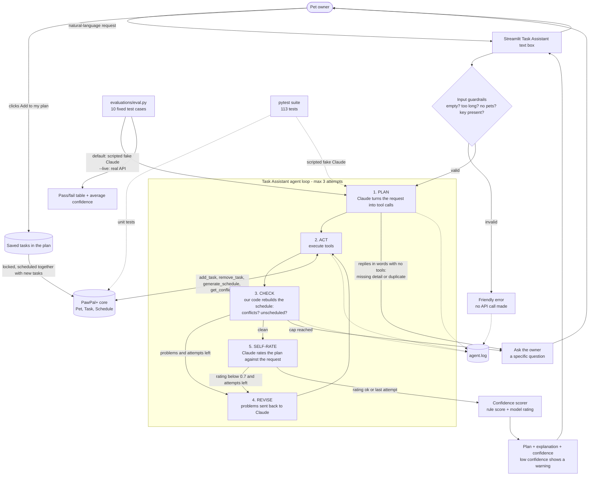

# PawPal+

You are building **PawPal+**, a Streamlit app that helps a pet owner plan care tasks for their pet.

## Original project and this extension

PawPal is a Streamlit app that helps a busy pet owner plan daily care for their pets. The owner enters pets and tasks (duration, priority, an optional fixed time, and how often a task repeats), and a deterministic scheduler builds a day plan with priority ordering, fixed start times, conflict detection and recurring tasks, then explains every decision in plain language. It contained no AI: every placement came from a rule the scheduler could explain.

**Task Assistant (an agentic workflow):** The owner can now type what their pets need in plain English, for example _"Walk Max for 30 minutes every morning and give Luna her inhaler at 8:30am."_ Claude (`claude-sonnet-5-5`) turns the request into tool calls that run against the real PawPal+ classes, then the system checks its own work: the code rebuilds the schedule and looks for conflicts, Claude reviews the plan against the original request, and problems are sent back for revision (up to 3 attempts). If it still can't produce a clean plan, or the request is missing something important, it asks the owner one specific question instead of guessing. Every plan comes with a confidence score, and nothing is saved until the owner clicks "Add to my plan".

Typing a sentence is much easier than filling in forms, but an assistant that silently invents a medication time or duration is worse than no assistant. The checks, guardrails, logging, confidence score and eval script exist to make the AI part trustworthy and measurable, not just impressive.

**AI features added:** Agentic workflow (plan, act, check, revise), plus a reliability layer: input guardrails, error handling, logging to `agent.log`, confidence scoring, and an evaluation script (`evaluations/eval.py`).

## Scenario

A busy pet owner needs help staying consistent with pet care. They want an assistant that can:

- Track pet care tasks (walks, feeding, meds, enrichment, grooming, etc.)
- Consider constraints (time available, priority, owner preferences)
- Produce a daily plan and explain why it chose that plan

Your job is to design the system first (UML), then implement the logic in Python, then connect it to the Streamlit UI.

## Getting started

### Setup

```bash
python -m venv .venv
source .venv/bin/activate  # Windows: .venv\Scripts\activate
pip install -r requirements.txt
```

### Setup for the Task Assistant (AI)

The scheduler works without any key. The Task Assistant needs an Anthropic API key and a little API credit (a full 10-case eval run costs a few cents). Tested on Python 3.13.

1. Create a key at [console.anthropic.com](https://console.anthropic.com) and make sure the account has credits.
2. In the project folder, create a file named `.env` containing one line (it is listed in `.gitignore`, so it won't be committed):

   ```
   ANTHROPIC_API_KEY=your-key-here
   ```

3. Start the app: `streamlit run app.py`, then use the Task Assistant section.

### Troubleshooting

- **"ANTHROPIC_API_KEY is missing" even though `.env` has the key:** The running Streamlit server only reads `.env` when it starts. Stop it (Ctrl+C) and run `streamlit run app.py` again.
- **"The API returned an error (400)":** The most common cause is a low credit balance. Go to the Anthropic console to add some credits.

## Features

- **Owner, pets and tasks:** Create, edit and delete pets and tasks (title, description, duration in minutes, priority, one or more pets).
- **Priority scheduling:** Tasks are placed in priority order, and a higher priority number is scheduled first. Ties keep the order they were entered in.
- **Fixed start times:** Pin a task to an exact time (like a vet appointment). Fixed tasks are placed first, then flexible tasks fill the earliest gap that fits.
- **Conflict detection:** If two fixed tasks overlap, the higher-priority one keeps its slot and the other is dropped and reported as a conflict, naming both tasks. Back-to-back tasks don't conflict.
- **Recurring tasks:** A task can repeat daily or on specific weekdays, or happen once on a date. A schedule is built for a chosen date and only plans the tasks due that day.
- **Sorting and filtering:** View tasks and schedules sorted by start time and filtered by pet.
- **Plan explanations:** Every schedule can explain itself. Each placed task gets a reason (pinned time, or its priority rank and the earliest free gap), each unscheduled task says why it was left out, and `explain()` turns it into a short summary. The app shows it under "Why this plan?".
- **Time totals and unscheduled tasks:** See how many minutes are planned and left, and which tasks didn't fit the window (or fall outside it, for fixed tasks).

**New in the final project (Task Assistant, AI):**

- **Plain-English planning:** Describe one or several tasks in a sentence. Claude adds them using validated tools (`agent_tools.py`), so a bad pet name, time or duration comes back as an error it can fix rather than corrupting the plan.
- **Self-checking agent loop:** After each attempt the code rebuilds the schedule and checks for conflicts and unscheduled tasks; Claude also rates how well the plan matches the request. Problems, or a rating below 0.7, send the plan back for revision (max 3 attempts).
- **Asks instead of guessing:** If details are missing, the request repeats something already saved, or a conflict can't be solved, the assistant asks the owner a specific question.
- **Aware of your saved tasks:** The schedule covers saved and new tasks together. Saved tasks are locked, so the assistant fixes conflicts by changing the new task, never yours.
- **Recurring-task aware:** Tasks that repeat on other days are listed as "saved, but not due" on the planned date instead of silently disappearing.
- **Confidence score:** The average of a rule-based score (fewer revision attempts and some free time means higher confidence) and Claude's own rating. Low confidence shows a warning.
- **Guardrails, logging and error handling:** Empty, oversized or pet-less requests and a missing API key are rejected before any API call; API failures become friendly messages; every step is logged to `agent.log`.
- **Human in the loop:** Nothing is saved until the owner clicks **Add to my plan**.
- **Note:** in the current app the Task Assistant is how tasks are added (the manual task form is commented out in `app.py`).

## Architecture Overview

The Task Assistant sits on top of the existing PawPal scheduler. The diagram's source is also in [`diagrams/ai-system-design.mmd`](diagrams/ai-system-design.mmd).



**How data flows:**

1. **Input:** The owner types a request into the Task Assistant box in the Streamlit app. Input guardrails reject empty or oversized requests, a request with no pets, and a missing API key before any API call is made.
2. **Process:** The agent loop runs plan, act, check, revise. Claude calls tools that wrap the real PawPal classes (add a task, remove one of its own tasks, generate the schedule, read conflicts). Then the code rebuilds the schedule and checks for conflicts, because the scheduler is deterministic and we don't take the model's word that it checked. A clean plan is also reviewed by Claude against the original request; a rating below 0.7 sends it back for revision. The loop gets at most 3 attempts. If Claude replies in words without calling tools (a missing detail, or a request that repeats something already saved), or the attempts run out, the owner gets a specific question instead of a guess.
3. **Output:** A clean plan is scored for confidence (rule-based checks plus the model's self-rating) and shown with a plain-English explanation and a warning when confidence is low. The owner then decides whether to click **Add to my plan**.

**Humans testing to check the AI:** The owner reviews the plan and the confidence score and answers clarification questions. `evaluations/eval.py` runs 10 fixed cases through the same agent (offline with a scripted fake Claude by default, or against the real API with `--live`) and reports pass/fail, attempts and confidence. The pytest suite tests the scheduling core and the agent with a scripted fake Claude. Every step is written to `agent.log`.

**Where each piece lives:**

| File                        | Role                                                                                               |
| --------------------------- | -------------------------------------------------------------------------------------------------- |
| `plan_assistant.py`         | The agent loop, input guardrails, logging, error handling, clarifying questions, model self-rating |
| `agent_tools.py`            | The tools Claude can call, with input validation; saved tasks are locked here                      |
| `evaluations/confidence.py`             | Rule-based confidence score and the combining logic                                                |
| `app.py`                    | The Task Assistant section of the Streamlit app                                                    |
| `evaluations/eval.py`, `fake_claude.py` | The evaluation script and the scripted stand-in for Claude                                         |
| `tests/test_agent.py`       | Tests for the tools, confidence scoring and agent loop                                             |

## ▶Running it

```bash
streamlit run app.py   # the interactive app
python main.py         # the CLI demo script (Steps 10-11 test the assistant offline)
pytest                 # the test suite
python evaluations/eval.py         # evaluate the Task Assistant offline (free, scripted fake Claude)
python evaluations/eval.py --live  # evaluate it against the real Claude API (costs a few cents)
```

## Sample Output

Output from the CLI demo (`python main.py`), Step 4. Tasks are placed back to back from the start of the schedule window, with the highest priority number first:

```
Step 4: Schedule - Today (08:00-20:00)
  08:00-08:30  Morning walk
  08:30-08:35  Give joint supplement
  08:35-08:50  Clean litter box
  08:50-09:35  Playtime
  Total time:     95 min
  Available time: 625 min
  Unscheduled:    0
```

Each schedule can also explain itself (`schedule.explain()`), which the demo prints after Step 4:

```
Planned 08:00-20:00: 4 task(s) scheduled (95 min, 625 min left).
Tasks pinned to a time are placed first. The rest go in priority order (highest number first), each into the earliest free gap that fits.
- 08:00-08:30 Morning walk: Priority 4 (ranked 1 of 4 flexible task(s)), so it took the earliest free time.
- 08:30-08:35 Give joint supplement: Priority 3 (ranked 2 of 4 flexible task(s)), so it took the earliest free time.
...
```

Step 8 pins a Vet checkup at 9:00 and a Grooming at 9:30. They overlap, so the higher-priority Vet keeps its slot and Grooming is reported as a conflict:

```
Step 8: Fixed times and conflicts
  08:00-08:30  Morning walk
  08:30-08:35  Give joint supplement
  08:35-08:50  Clean litter box
  09:00-10:00  Vet checkup
  10:00-10:45  Playtime
  CONFLICT: Grooming (09:30) overlaps Vet checkup
  Unscheduled: Grooming
    Why: Pinned to 09:30, but that overlaps 'Vet checkup' (09:00-10:00), which has higher priority.
```

Step 9 builds a separate schedule for each day of the current week (the dates depend on when you run it). Here Grooming repeats on Wed and Fri, and a one-time Vet appointment is on Wednesday, so they only clash on Wednesday:

```
    Wed Oct 14: 08:00 Morning walk, 08:30 Give joint supplement, 08:35 Clean litter box, 08:50 Playtime, 10:00 Vet appointment
        CONFLICT: Grooming overlaps Vet appointment
    Thu Oct 15: 08:00 Morning walk, 08:30 Give joint supplement, 08:35 Clean litter box, 08:50 Bath time, 09:30 Playtime
    Fri Oct 16: 08:00 Morning walk, 08:30 Give joint supplement, 08:35 Clean litter box, 08:50 Playtime, 10:15 Grooming
```

## Task Assistant: Sample Interactions

These are real runs against `claude-sonnet-5-5` (planning date Monday 2026-11-16, pets Max the dog and Luna the cat). Model output varies a little from run to run, so your wording and numbers may differ slightly. Sample 1's plan is saved first, so samples 3 and 4 run with it as the owner's saved tasks.

**1. A request with three tasks**

```
Input:  Walk Max for 30 minutes every morning, give Luna her inhaler at 8:30am for 5 minutes every day,
        and play with Luna for 20 minutes in the evening.
Status: ok | attempts: 3 | confidence: 0.77
  08:00-08:30 Morning walk
  08:30-08:35 Luna inhaler
  18:00-18:20 Evening playtime
Confidence note: rule 0.60, model 0.93 (All three tasks match the request on pet, duration, and daily repeat...)
```

The agent log shows why it took 3 attempts: the self-review rated the first two plans 0.60 because the evening playtime had been saved as a one-time task instead of a daily one, and sent them back for revision. The third attempt fixed it. The rule score is lower (0.60) because of the extra attempts, which is intended.

**2. A missing detail (an assumption the review caught)**

```
Input:  Give Max his joint supplements at noon.
Status: ok | attempts: 1 | confidence: 0.95
  12:00-12:05 Joint supplements
Confidence note: rule 1.00, model 0.90 (The task matches the pet (Max), the time (12:00), and the action, but the request
never specified a date or recurrence, so the one-time rule on 2026-11-16 is an assumption, and the 5-minute duration is also assumed.)
```

No duration was given and this run assumed 5 minutes, although the instructions say not to invent durations. An earlier run of a similar request asked for the duration instead. The reviewer noticed the assumption, but a 0.90 is generous for an invented supplement duration. This is documented under Known limitations and in `model_card.md`.

**3. A request that repeats a saved task**

```
Input:  Walk Max for 30 minutes every morning.
Status: needs_clarification | attempts: 1
Assistant: Max's 30-minute morning walk is already in your plan. It repeats daily, so I haven't added anything new.
```

**4. A request that clashes with a saved task**

```
Input:  Vet visit for Max at 8:30am for 45 minutes on Monday.
Status: ok | attempts: 3 | confidence: 0.6
  08:00-08:30 Morning walk
  08:30-08:35 Luna inhaler
  08:35-09:20 Vet visit
  18:00-18:20 Evening playtime
Confidence note: rule 0.60, model 0.60 (... pinned to 08:35 instead of the requested 08:30 (shifted to avoid the Luna inhaler conflict...))
```

The saved inhaler was never touched; the new vet visit moved to the first free time after it. The confidence is below 0.7, so the app shows a "please review this plan" warning.

**5. Questions the assistant asks instead of guessing**

```
Input:  Do something nice for my pets
Status: needs_clarification | attempts: 1
Assistant: Your request doesn't give me enough to build a plan, so I haven't added any tasks. "Do something nice" doesn't
say which activities you want, how long they should take, or whether they should be one-time or recurring.
Please tell me: 1. What to do ... 2. Which pet or pets ... 3. How long ... 4. When, if you want a specific start time ...

Input:  Vet for Luna at exactly 2pm for 60 minutes AND grooming for Max at exactly 2pm for 60 minutes. Neither can move.
Status: needs_clarification | attempts: 3
Assistant: Since Luna's vet visit and Max's grooming can't both be at 14:00, which one should move, and to what start time?
```

## Testing PawPal+

```
# Run the full test suite:
pytest

# Pytest Output
============================= test session starts ==============================
platform darwin -- Python 3.13.0, pytest-9.1.1, pluggy-1.7.0
rootdir: /Users/Wheatley/Desktop/AI110/ai110-module2show-pawpal-starter
configfile: pytest.ini
testpaths: tests
plugins: anyio-4.15.1
collected 63 items

tests/test_pawpal.py ............................................................... [100%]

============================== 63 passed in 0.03s ==============================
```

The tests in `tests/test_pawpal.py` cover:

- **Basics:** tasks, pets, users and schedules (adding, removing, setters, no shared lists).
- **Scheduling:** priority order and ties, windows that are too small, exact fits, regenerating, and no tasks.
- **Placements:** they live on the schedule, so generating never changes a task and one task can have different times in different schedules.
- **Sorting and filtering:** by start time (unscheduled last) and by pet (matched by identity, so two pets with the same details stay separate).
- **Fixed times and conflicts:** gap filling, overlap resolution by priority, back-to-back tasks, tasks outside the window, and conflicts clearing on regenerate.
- **Recurring tasks:** daily, weekly, one-time and any-day tasks, per-day schedules, and conflicts that only happen on days both tasks occur.
- **Explanations:** reasons for pinned, flexible, and unscheduled tasks (overlap, outside the window, no gap long enough), a task going around a fixed task, reasons resetting on regenerate, tasks skipped as not due, and the `explain()` summary.

## Testing the Task Assistant

Commands to reproduce everything below:

```bash
pytest                 # 113 tests, no API calls
python evaluations/eval.py         # offline evaluation, writes evaluations/results/eval_results_offline.md
python evaluations/eval.py --live  # live evaluation against the real API, writes evaluations/results/eval_results_live.md
python main.py         # Step 10 (tools) and Step 11 (assistant) print PASS/FAIL lines
```

**Full test run** (the 63 scheduler tests above plus 50 new ones in `tests/test_agent.py`):

```
============================= test session starts ==============================
collected 113 items

tests/test_agent.py ..................................................   [ 44%]
tests/test_pawpal.py ................................................... [ 89%]
............                                                             [100%]

============================= 113 passed in 0.90s ==============================
```

`tests/test_agent.py` covers: tool validation (bad pets, times, durations, priorities, dates), locked saved tasks, confidence scoring and rating parsing, the plan-check-revise loop (fixed on attempt 2, question after the cap), asking directly instead of retrying, low self-rating triggering a revision, tasks not due on the plan date, tool errors reaching the model, a failed or malformed self-rating not breaking a good plan, refusals, and every input guardrail. I also checked that the tests can fail: deliberately breaking the attempt cap, the tool-error flag and the refusal check each made a test fail, and the code was restored afterwards.

**Evaluation script, offline mode** (`python evaluations/eval.py`): Claude's replies are scripted, so this tests everything around the model (guardrails, the check and revise loop, the attempt cap, confidence scoring), not the model itself:

| #   | Test                  | Expected            | Actual              | Attempts | Confidence | Result |
| :-- | :-------------------- | :------------------ | :------------------ | :------- | :--------- | :----- |
| 1   | Simple task           | ok                  | ok                  | 1        | 0.95       | Pass   |
| 2   | Pinned time           | ok                  | ok                  | 1        | 0.95       | Pass   |
| 3   | Three tasks, two pets | ok                  | ok                  | 1        | 0.95       | Pass   |
| 4   | Fixable conflict      | ok                  | ok                  | 2        | 0.85       | Pass   |
| 5   | Impossible conflict   | needs_clarification | needs_clarification | 3        | -          | Pass   |
| 6   | Unknown pet           | needs_clarification | needs_clarification | 2        | -          | Pass   |
| 7   | Vague request         | needs_clarification | needs_clarification | 1        | -          | Pass   |
| 8   | Empty input           | error               | error               | 0        | -          | Pass   |
| 9   | Oversized input       | error               | error               | 0        | -          | Pass   |
| 10  | No pets added         | error               | error               | 0        | -          | Pass   |

**10 of 10 runs passed.**
Average confidence on successful plans: 0.92; average attempts: 1.2.

**Evaluation script, live mode** (`python evaluations/eval.py --live`, real `claude-sonnet-5-5`). This is the test of the model itself:

| #   | Test                  | Expected            | Actual              | Attempts | Confidence | Result |
| :-- | :-------------------- | :------------------ | :------------------ | :------- | :--------- | :----- |
| 1   | Simple task           | ok                  | ok                  | 1        | 0.95       | Pass   |
| 2   | Pinned time           | ok                  | ok                  | 1        | 0.95       | Pass   |
| 3   | Three tasks, two pets | ok                  | ok                  | 1        | 0.97       | Pass   |
| 4   | Fixable conflict      | ok                  | ok                  | 1        | 0.95       | Pass   |
| 5   | Impossible conflict   | needs_clarification | needs_clarification | 3        | -          | Pass   |
| 6   | Unknown pet           | needs_clarification | needs_clarification | 1        | -          | Pass   |
| 7   | Vague request         | needs_clarification | needs_clarification | 1        | -          | Pass   |
| 8   | Empty input           | error               | error               | 0        | -          | Pass   |
| 9   | Oversized input       | error               | error               | 0        | -          | Pass   |
| 10  | No pets added         | error               | error               | 0        | -          | Pass   |

**10 of 10 runs passed.**
Average confidence on successful plans: 0.95; average attempts: 1.0.

**Guardrail and reliability results:**

| Input                                            | Behavior                                        | Result                                                                                          |
| :----------------------------------------------- | :---------------------------------------------- | :---------------------------------------------------------------------------------------------- |
| Blank request                                    | Rejected before any API call                    | "Please type a request, for example: 'Walk Max for 30 minutes every morning.'"                  |
| 2,600-character request                          | Rejected before any API call                    | "That request is too long (2600 characters). Keep it under 1000."                               |
| Any request with no pets                         | Rejected before any API call                    | "Add at least one pet first so the assistant knows who the tasks are for."                      |
| No API key                                       | Rejected before any API call                    | "ANTHROPIC_API_KEY is missing. Add it to your .env file."                                       |
| "Walk Rex for 30 minutes" (Rex is not a pet)     | The tool returns an error naming the real pets  | Live: Claude asked the owner (`needs_clarification`, 1 attempt) instead of guessing             |
| Two tasks both pinned to 2pm, "neither can move" | The checker finds the conflict on every attempt | After 3 attempts: "...which one should move, and to what start time?"                           |
| "Do something nice for my pets"                  | Claude replies in words without calling tools   | Asked what, which pet, how long and when; no tasks invented                                     |
| Model refuses a request                          | Raised and caught inside the agent              | Friendly error result (tested with a scripted refusal)                                          |
| Self-rating call fails or is unparseable         | The plan is still returned                      | Confidence falls back to the rule score alone, and the note says the rating is unavailable      |
| A bad key or exhausted credits                   | Caught by the error handling chain              | A friendly error instead of a crash (the wording for credits is generic; see Known limitations) |

## Smarter Scheduling

| Feature            | Method(s)                                                                                                                     | Notes                                                                                                                                                            |
| ------------------ | ----------------------------------------------------------------------------------------------------------------------------- | ---------------------------------------------------------------------------------------------------------------------------------------------------------------- |
| Priority ordering  | `Schedule.generate_schedule`                                                                                                  | Higher priority number is placed first. Ties keep the order they were entered in.                                                                                |
| Sorting by time    | `Schedule.get_tasks_by_time`, `Schedule.sort_tasks_by_time`                                                                   | Placements in clock order, or any list of tasks ordered by their time in a schedule (tasks not in it go last).                                                   |
| Filtering by pet   | `filter_by_pet`, `User.get_tasks_for_pet`, `Schedule.get_tasks_for_pet`                                                       | Matches the exact pet object.                                                                                                                                    |
| Fixed start times  | `Task.fixed_start`, `Schedule.generate_schedule`                                                                              | Fixed tasks are placed first, then flexible tasks take the earliest gap that fits.                                                                               |
| Conflict detection | `Schedule.get_conflicts`                                                                                                      | Returns (dropped task, task it overlaps) pairs. The higher-priority fixed task wins and the other is also listed as unscheduled.                                 |
| Unscheduled tasks  | `Schedule.get_unscheduled_tasks`                                                                                              | Tasks that don't fit the window, fixed tasks outside it, and conflict losers. Shorter tasks after a skipped one can still fit.                                   |
| Recurring tasks    | `Task.repeat_days`, `Task.on_date`, `Task.occurs_on`, `Task.describe_repeat`, `User.get_tasks_for_date`, `Schedule.plan_date` | Daily or chosen weekdays, or a single date. A schedule with a `plan_date` only plans tasks due that day.                                                         |
| Plan explanations  | `Schedule.explain`, `Schedule.get_reason`, `ScheduledTask.get_reason`, `Schedule.get_not_due_tasks`                           | Reasons are written at the moment each decision is made (no extra pass, no AI needed), so the summary is cheap and always matches what the scheduler really did. |
| Time totals        | `Schedule.get_total_time`, `Schedule.get_available_time`                                                                      | Calculated from the scheduled tasks (in minutes) instead of stored.                                                                                              |
| Placements         | `ScheduledTask`, `Schedule.get_placement`                                                                                     | Start and end times are stored on the schedule, not on the task.                                                                                                 |

## Demo Walkthrough

**CLI demo (`python main.py`):**

1. **User:** create a `User` with a username, email and password.
2. **Pets:** add pets to the user, each with a breed, age, health conditions and medications.
3. **Tasks:** create tasks with a duration in minutes and a priority (higher number first), and link each task to one or more pets.
4. **Schedule:** create a schedule (default window 8am to 8pm) and call `generate_schedule` with the user's tasks. Each task gets a start and end time, stored on the schedule.
5. **Tight window:** shrink the window to 8am to 9am and regenerate. A task that no longer fits goes to the unscheduled list.
6. **Edge cases:** no tasks, a task longer than the whole window, and equal priorities.
7. **Sorting and filtering:** sort tasks by start time with unscheduled ones last, filter by pet, and show one task at different times in two schedules.
8. **Fixed times and conflicts:** pin two overlapping tasks, see the conflict reported, and see a fixed task outside the window left unscheduled.
9. **Recurring tasks:** set tasks to repeat daily or on chosen weekdays, add a one-time task, and build a schedule for each day of the week.

**Streamlit app (`streamlit run app.py`):**
**!! with AI task assistant !!**

1. Add the owner and pets.
2. Type in your task request into the textbox and click "Ask Task Assistant" and wait. If ask clarification questions, update your prompt. If a plan is generated, review before clicking "Add to my plan"
3. In Build Schedule, the schedule will be generated for the week and the day. If you added tasks for a later time, you'll find it in "Week at a glance" otherwise, you'll see your tasks in the schedule table.

## Known limitations

- Data lives in memory for the session only, so it resets when the app restarts.
- The scheduler doesn't reject zero or negative durations or an end time before the start time (the app form limits duration to 1-240 minutes).
- A conflict drops the lower-priority fixed task instead of suggesting a new time for it.
- Recurring tasks have no "done" state or end date yet.

**Task Assistant limitations:**

- It needs an internet connection and API credit, and each request makes several API calls (roughly 5 to 25 seconds, and each attempt adds a plan call plus a review call).
- Output varies between runs. The same request can lead to a question one time and an assumption the next (see sample interaction 2), and the evaluation cases are only single runs unless `--runs` is used.
- The confidence score is a heuristic, not a calibrated probability. Claude's self-rating can be generous (it accepted an invented supplement duration at 0.90) or picky (it sent a sensible plan back twice over an ambiguous phrase).
- A schedule covers one day at a time, so a task that repeats on other days shows as "saved, but not due" instead of appearing in the plan.
- The assistant can't edit or remove tasks you already saved; it can only add new ones around them.
- Some API errors share a generic message (for example a 400 caused by low credits reads "The API returned an error (400). Try again shortly."), and `agent.log` records that same short message.
- The offline evaluation uses scripted replies, so it can't catch problems that only appear with the real model; two real bugs were only found by live testing (see Testing Summary).

## Design Decisions

- **A agent loop with our own checker, not "ask the model to verify itself".** The scheduler is deterministic, so after every attempt our code rebuilds the schedule and looks for conflicts and unscheduled tasks. The model's self-rating is an additional signal, not the only one. The trade-off is more code than letting the model grade itself.
- **Tools wrap the existing classes and validate everything.** Claude never touches PawPal+ objects directly. A bad pet name, time or duration comes back as an error message the model can read and fix, and a last-resort handler stops one bad call from crashing the agent.
- **Three attempts, then a specific question.** Retrying forever costs money and invites guessing. After 3 attempts (or as soon as Claude replies in words with no tools) the owner gets a question. The trade-off is that some solvable requests end in a question, and each extra attempt adds seconds.
- **Two-signal confidence.** The rule score (attempts used, free time in the day) is cheap and predictable; the model rating understands the request. Averaging them is simple but crude, and a rating below 0.7 triggers a revision, which improves plans at the price of latency.
- **Saved tasks are locked.** The assistant schedules around what the owner already saved and fixes clashes by moving the new task. This is safer than letting an AI delete tasks the user created.
- **Nothing is saved until the owner clicks Add to my plan.** The owner is the final check.
- **Offline fake plus a live flag.** A scripted fake Claude makes the tests and evaluation free and reproducible for anyone, with no key. `--live` is opt-in so it never spends money by accident. The trade-off is that offline results only prove the harness works.
- **Model and settings.** `claude-sonnet-5-5` with medium effort for a good balance of cost and speed, tool choice left on `auto` (this model rejects forced tool choice), and Anthropic's server-side fallback enabled in case a safety classifier declines a request.
- **Streamlit only.** A command-line entry point was planned and dropped to keep the scope small; `main.py` still demonstrates the tools and the assistant offline.

## Testing Summary

- **What worked:** 113 tests pass; the offline evaluation passes 10 of 10; the live evaluation passes 10 of 10 (average confidence 0.95 on successful plans); every deliberately introduced bug was caught by a test. The confidence note is useful, since the reviewer's one-sentence reasons exposed real gaps (a one-time task that should repeat, a shifted start time, an assumed duration).
- **What didn't, and what live testing found:**
  - The first live evaluation passed 9 of 10. Asking the clarifying question re-sent the conversation without the tools list, and the API rejected it because Claude's saved reasoning is tied to that list. Fixed by keeping the tools and setting `tool_choice` to `none`; a regression test now locks it in. The scripted fake could never have caught this.
  - Trying the app by hand showed that the agent threw away Claude's own questions and retried (pressuring it to invent a duration), that it reported an "ok" empty plan with 0% confidence when a repeating task simply wasn't due that day, that it ignored tasks the owner had already saved, and that a poor self-rating only reported a low score instead of triggering a revision. Each was fixed and covered by new tests.
  - The very first live attempt failed with a generic 400 error; the real cause was zero API credit.
- **What I learned:** Scripted tests prove the basic idea works but only the real model reveals how it behaves, so both are needed. A readable log (`agent.log`) turned a vague bugs into specific, fixable problems. And the same prompt does not always give the same answer, so the system has to be built to catch the difference, not to assume it won't happen.

## Reflection

Building the task assistant taught me that the AI call is the easy part; most of the work is deciding what to do when the model is wrong, vague or quietly confident. Splitting the work into a deterministic scheduler (which can be tested exhaustively) and a model that only proposes tasks through validated tools made the system much easier to reason about and test. Checks that don't depend on the model's own word, such as rebuilding the schedule in code, caught problems that I never would have otherwise.
